# vr-piano

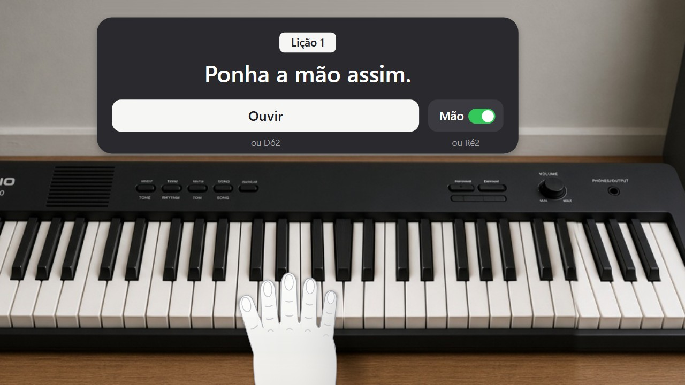

Aprenda piano com o Meta Quest 3/3S e um teclado Casio CT-S300 de verdade. O app mostra no teclado real onde pôr a mão, toca junto com você e depois apaga as luzes para você tocar de cabeça.

Planejamento, sem implementação ainda. As imagens abaixo são a prova de conceito visual: mostram o que a pessoa vê no headset, passo a passo, antes de existir código.

> Os balões roxos são explicação desta página. Eles não aparecem no app.

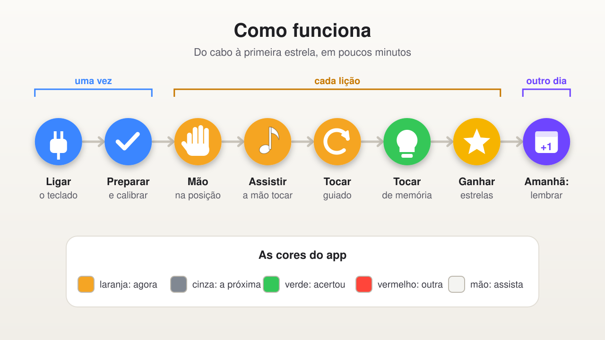

## Antes da primeira aula (uma vez só)

**1. Ligue o teclado no Quest.** Um cabo de dados vai do teclado (Micro-B) ao headset (USB-C). O teclado fica na tomada.

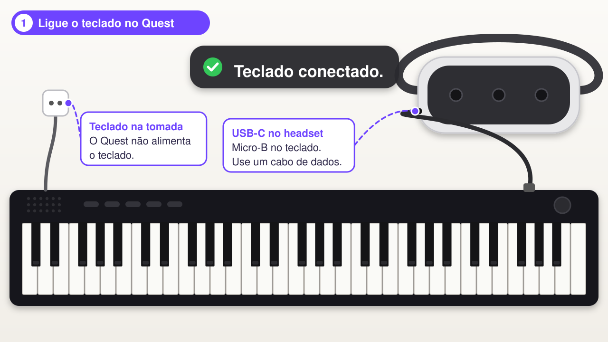

**2. Prepare o teclado.** Cinco ajustes no próprio teclado, marcados com uma pinça.

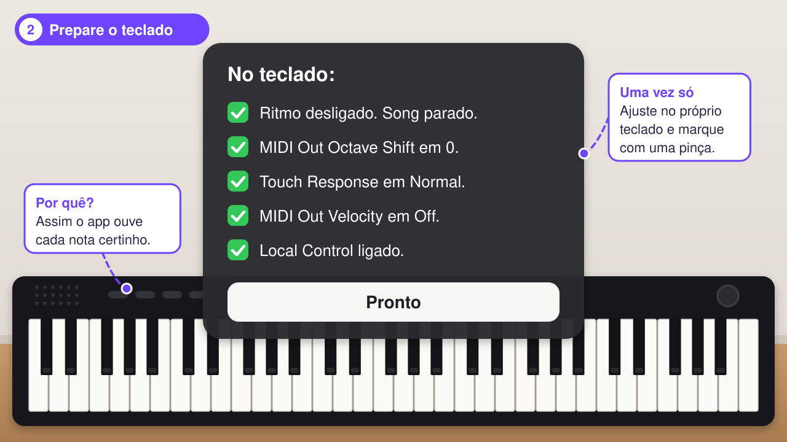

**3. Mostre onde está o teclado.** Aponte e toque a tecla da ponta esquerda, depois a da direita. O app desenha as 61 teclas por cima das reais.

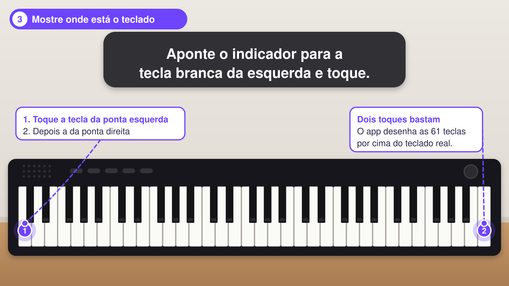

**4. Confira o dó central.** Se acender no lugar certo, pronto. Nas próximas vezes, só este passo.

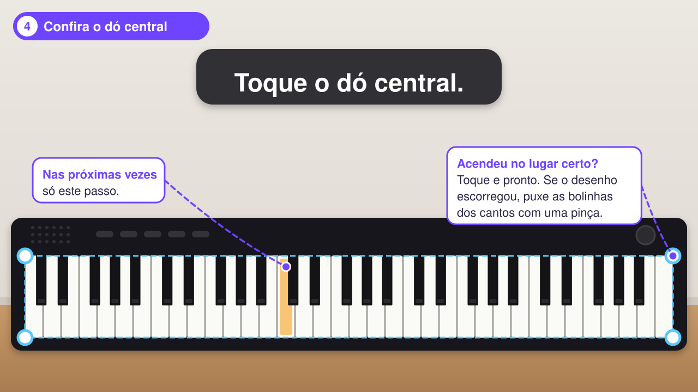

## A aula

**5. Mão na posição.** A mão branca mostra onde pôr a sua: polegar no dó, um dedo em cada tecla. Quando a sua encaixa, a aula começa sozinha.

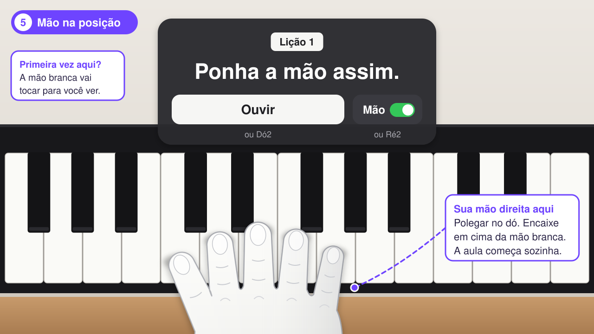

**6. Ouvir (se quiser).** O próprio piano toca a sequência devagar e a mão branca mostra qual dedo desce.

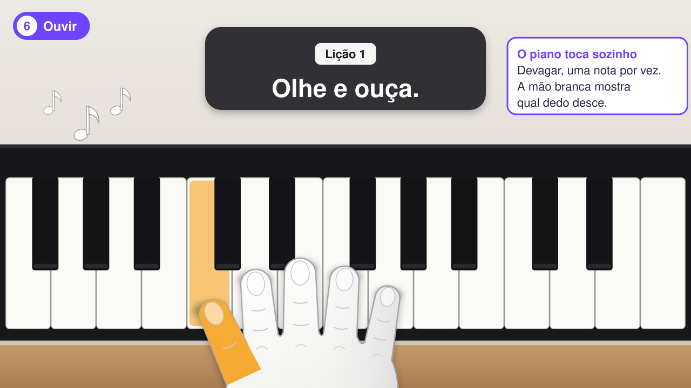

**7. Toque junto.** A tecla laranja e o dedo laranja dizem o que tocar. A mão branca espera você, sem relógio. No fim da sequência, ela recomeça.

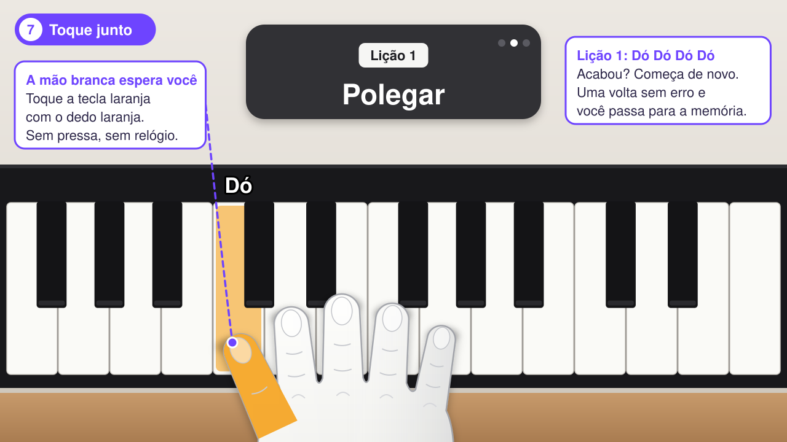

**8. Errou? Tudo bem.** A tecla errada fica vermelha e a certa continua esperando. Nada se perde.

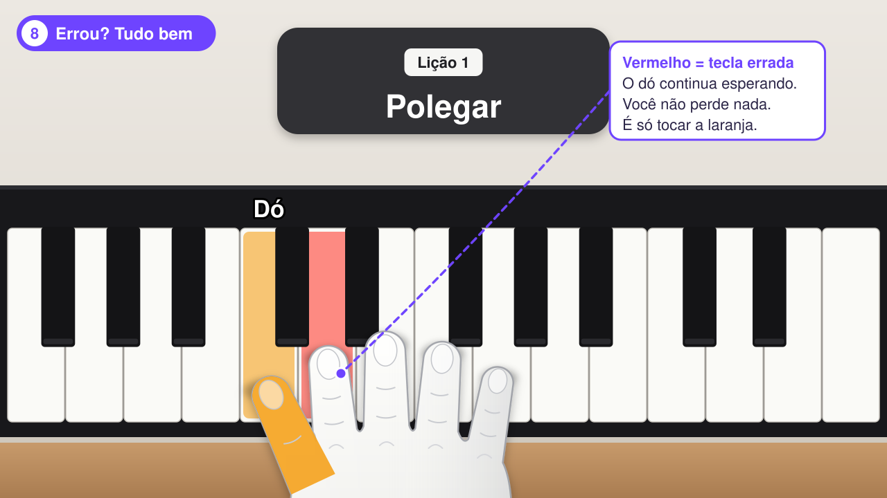

**9. Agora de cabeça.** Depois de uma volta sem erro, luz e mão somem. Você toca de memória.

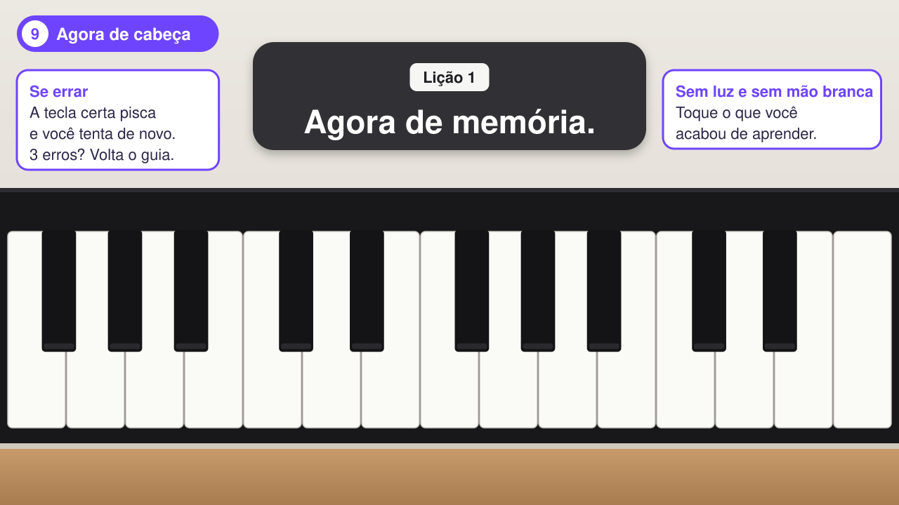

## Estrelas e progresso

**10. Ganhe estrelas.** Lembrou de primeira: 3 estrelas. Com 2, a próxima lição abre.

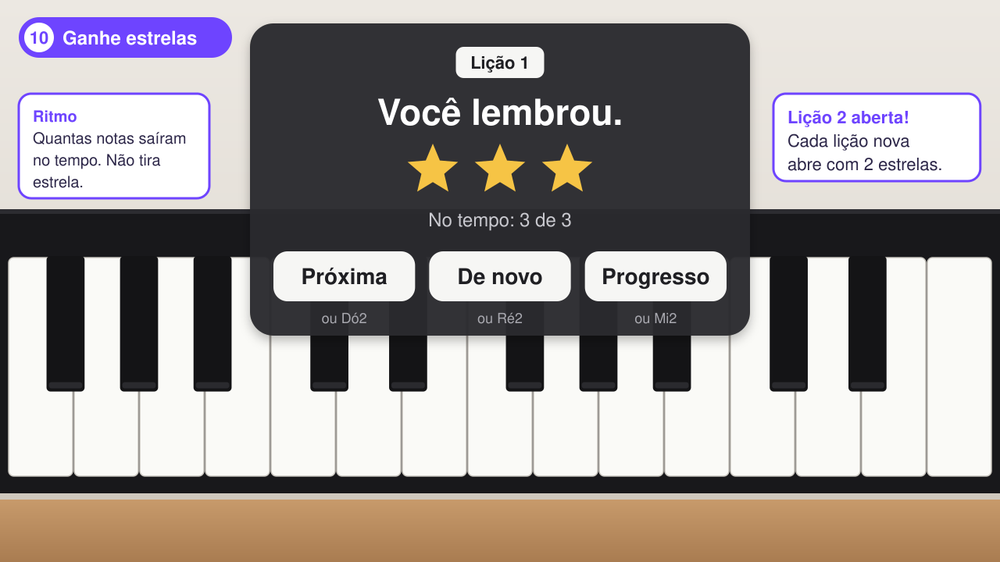

**11. Seu progresso.** Estrelas, dias seguidos e as 12 lições. Com as 12, abre a música do nível 1.

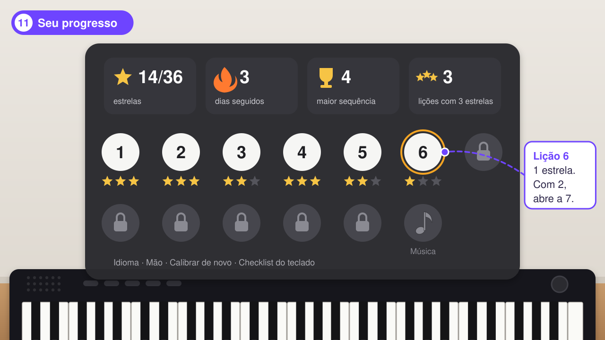

**12. No dia seguinte.** Antes de matéria nova, toque de memória a última frase. Isso conta nos dias seguidos.

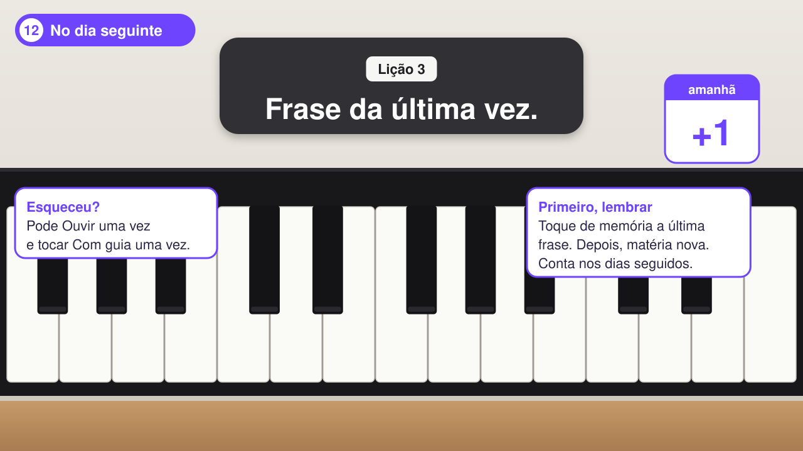

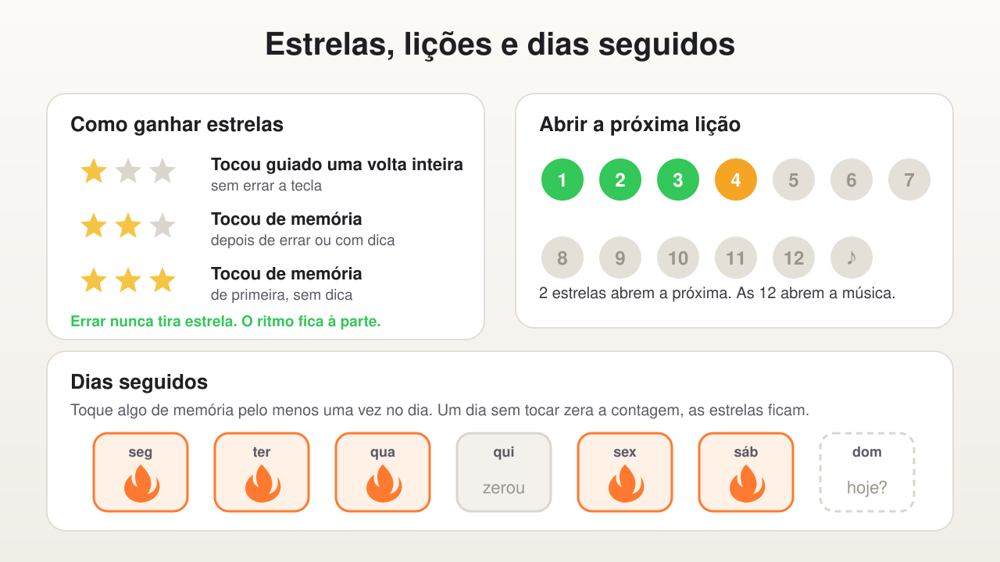

## Documentação

1. [Requisitos do sistema](docs/01-requisitos-do-sistema.md): decisões, currículo, requisitos funcionais e não funcionais.
2. [Jornada do usuário](docs/02-jornada-do-usuario.md): o que a pessoa vê e faz, tela por tela.
3. [Conceito do protótipo em AR](docs/03-conceito-prototipo-ar.md): camadas, cores, card, mão branca e recorte do protótipo.
4. [Testes](docs/04-testes.md): casos, matriz de rastreabilidade e ordem de execução.
5. [Arquitetura técnica](docs/05-arquitetura-tecnica.md): stack, ponte MIDI no Android, manifest, calibração, desempenho.
6. [Modelo do domínio](docs/06-modelo-de-dominio.md): máquina de estados, eventos, catálogo, arquivo de progresso e parâmetros.
7. [Textos da interface](docs/07-textos-da-interface.md): todas as frases em pt-BR e inglês.

Quando dois documentos divergirem, vale o 06 para regra e números, e o 01 para escopo.
