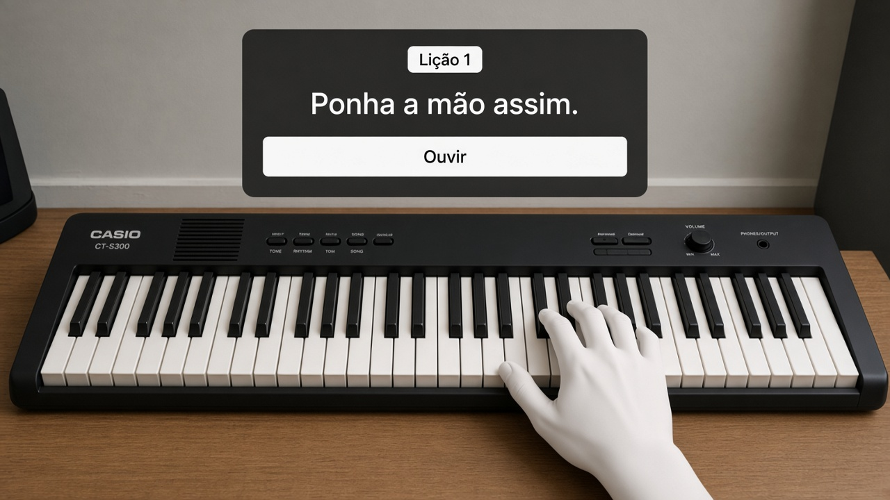

# vr-piano

App de piano em realidade mista para Meta Quest 3/3S e Casio CT-S300. Planejamento, sem implementação ainda.

- [Requisitos do sistema](docs/01-requisitos-do-sistema.md)
- [Jornada do usuário](docs/02-jornada-do-usuario.md)
- [Conceito do protótipo em AR](docs/03-conceito-prototipo-ar.md)
- [Testes](docs/04-testes.md)
