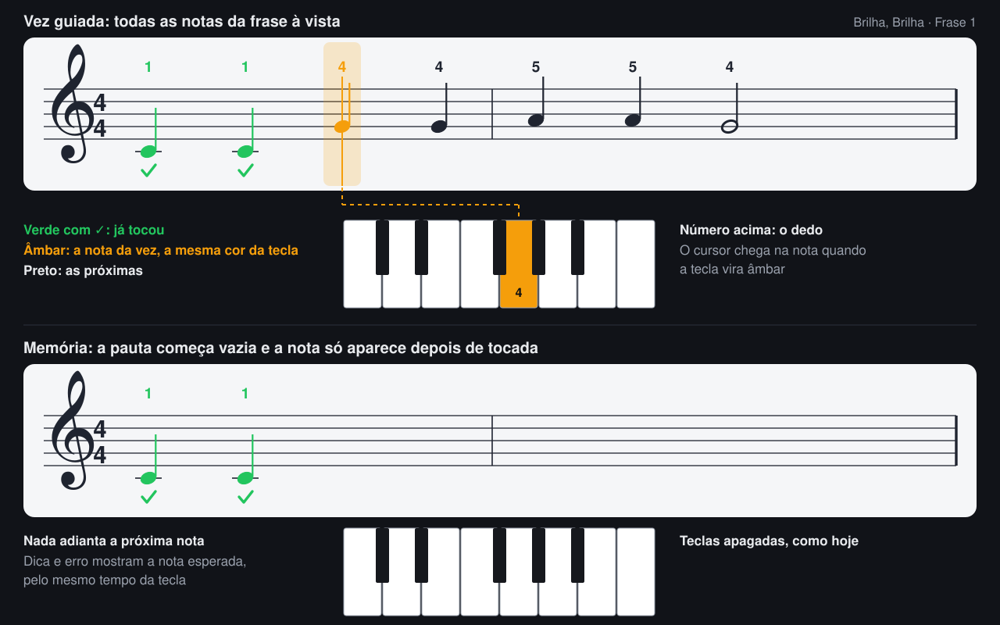

# Partitura dinâmica

Planejamento da partitura que acompanha a pessoa enquanto ela toca, em sincronia com o teclado.

**Situação: aprovada em 2026-11-06, a partir do protótipo na web.** Isso inclui a pauta parada com cursor e a memória com a pauta vazia (decisão 1 do §10). O [01](01-requisitos-do-sistema.md) ainda diz que partitura está fora da v1 e vale para escopo até os ajustes do §9. As decisões 2 e 3 do §10 seguem abertas.

**Protótipo:** `web/wwwroot/partitura.js` já mostra a pauta na web, para ver a ideia funcionando. As regras do §3 ainda estão em `main.js`, e não no domínio como pede o §5, e faltam a nota vermelha do erro, o controle “Partitura” e os testes.

## 1. O que a pessoa vê

Acima do teclado aparece a pauta da frase. As notas já tocadas ficam verdes com um ✓, a nota da vez fica âmbar, com a mesma cor da tecla, e as próximas ficam pretas, à vista. A pessoa olha adiante, como um pianista que lê a partitura.



## 2. Decisões propostas

| Tema | Proposta | Motivo |
|---|---|---|
| Movimento | A pauta fica parada e o cursor anda | É como um pianista lê. Na vez guiada a sequência tem 2 compassos e 7 a 9 notas, então cabe inteira. Uma faixa rolando pareceria a esteira que o 03 recusa. |
| Sequência longa | Uma linha por frase, com a linha atual e a seguinte à vista. Ao entrar na linha seguinte, a pauta sobe uma linha | Vale para a audição da música inteira e para as notas reveladas no Juntar. A troca lembra virar a página. |
| Memória | A pauta começa vazia e cada nota aparece depois de tocada | Mostrar a nota antes acabaria com a memória: a pessoa leria em vez de lembrar, e as estrelas e a “Decorada” perderiam o sentido. A pauta continua dinâmica. |
| Quem decide o que aparece | O domínio | Web e VR mostram o mesmo jogo (05 §13). A regra que esconde a nota não pode existir duas vezes. |
| Desenho | Próprio, sem biblioteca | VexFlow e OSMD só rodam em JS, e o Unity precisaria de outra solução. A v1 só usa clave de sol, 4 figuras, 6 notas e nenhum acidente, ligadura ou pausa. |
| Leitura | Número do dedo acima de cada nota | A pessoa ainda não lê pauta. O dedo e a cor sustentam a leitura, e a altura da nota na pauta vai sendo aprendida sem aula. |
| Controle | “Partitura” ligada por padrão, como “Mão” (RF-32c) | Permite comparar com e sem no teste com pessoas. |

## 3. O que aparece em cada fase

**Aberta** mostra todas as notas da sequência. **Oculta** mostra só as notas já tocadas.

| Fase | Modo | Sequência | Cursor |
|---|---|---|---|
| Pose de frase | Aberta | A frase | Na primeira nota |
| Pose da música inteira | Oculta | A música | Sem cursor |
| Demonstração e “Ouvir” | Aberta | O que está tocando | Segue a nota que soa |
| Guiada e “Com guia” | Aberta | A frase ou o trecho do erro | Segue o passo, ver §4 |
| Transição para a memória | Oculta | A da fase seguinte | As notas apagam durante `P-22` |
| Memória | Oculta | A frase | Na posição do passo, sem mostrar a nota |
| Juntar, música inteira e revisão | Oculta | A cadeia | Idem |
| RetornoDeErro | Oculta | A mesma | A nota esperada aparece em âmbar por `P-25` e volta ao ponto de recomeço |
| Ofertas | Oculta | A cadeia | Parado |
| Resultado | Aberta | A sequência tocada | Sem cursor, tudo verde |
| Pausado | O da fase anterior | A mesma | Parado |

A dica de memória mostra a nota da vez em cinza claro por `P-34`, junto com a piscada da tecla, e continua contando como dica.

## 4. Sincronia com o teclado

Tecla e nota leem a mesma fonte, e a partitura não guarda estado próprio. O que está verde sai de `Indice < Atual`. Assim, recomeçar uma volta, voltar ao começo do trecho depois de um erro e retomar de uma pausa funcionam sem código especial.

| Acontecimento | Tecla | Nota na pauta |
|---|---|---|
| `AlvoMudou` | Cor ativa ou cinza dinâmico | Passa a ser a nota da vez |
| `AtaqueChegou` | Cor ativa | Âmbar, com o cursor em cima dela |
| `NotaCerta` | Verde por `P-23` | Verde com ✓, até a volta acabar |
| `NotaErrada` | Vermelho por `P-24` na tocada | Nota vermelha na altura tocada, na coluna do cursor, por `P-24`. O cursor não anda |
| `DicaDeMemória` | Piscada por `P-34` | Nota da vez em cinza claro por `P-34` |
| `TentativaFalhou`, `JuntarFalhou` | Âmbar na esperada, vermelho na tocada | Âmbar na nota da vez por `P-25`, vermelho na altura tocada por `P-24` |
| `DemoNota` | Cor ativa enquanto soa | Âmbar enquanto soa |
| Mesma tecla em seguida (RF-32e) | Contorno na cor ativa | Duas notas separadas, sem regra nova |

**Cursor na vez guiada.** Ele usa o mesmo `progresso` do cinza dinâmico (06 §3.1):

```text
progresso = (t − tAcerto) / (tAtaque − tAcerto), limitado entre 0 e 1
x(t) = x(nota anterior) + (x(nota da vez) − x(nota anterior)) × progresso
```

O cursor chega à nota no instante em que a tecla vira âmbar, e ali espera sem limite (tempo elástico). Se a pessoa tocar antes, ele desliza por `P-36` até a nota seguinte. Nada anda sozinho além da nota da vez, então a pauta nunca deixa a pessoa para trás.

Tocar uma nota fora do alcance da pauta só pisca o cursor em vermelho. Numa tecla preta, a nota vermelha leva um sustenido.

## 5. Domínio

Hoje o domínio não sabe o suficiente para desenhar a pauta. Faltam quatro coisas.

**5.1 `Partitura` (novo, `domain/Partitura.cs`).** Monta os compassos a partir da `Musica`, sem mudar o formato do 06 §5.

```text
Partitura.DaMusica(musica) → Linhas[]                uma linha por trecho
  Linha     Trecho, Compassos[]
  Compasso  Numero, Notas[]
  NotaNaPauta
    Indice      o mesmo de Passo.Indice
    Tempo       posição no compasso, em tempos
    Figura      Minima, Seminima, Colcheia
    Pontuada, Viga (colcheias do mesmo tempo)
    Altura      Mao.IndiceDaTeclaBranca: dó central = 0
    Dedo
```

- Figura e tempo vêm de `start_time_ms`, `duration_ms` e `bpm`. As duas músicas têm 104 notas, em semínima, mínima, semínima pontuada e colcheia, sem pausa e sem nota atravessando a barra de compasso.
- A conta vale porque a v1 exige `bpm_map` vazio. Com mudança de andamento, o importador do [08](08-roadmap-importacao.md) terá de gravar a posição em tempos.
- Todas as notas ficam abaixo da linha do meio, então toda haste aponta para cima. A regra da haste só é necessária quando entrar nota mais aguda.

**5.2 `VisaoDaPartitura` (novo, em `SessaoDeLicao`).** Uma propriedade só de leitura diz o que mostrar agora: `Primeiro` e `Ultimo` (índices da sequência), `Atual` (índice, ou nulo) e `Modo` (Aberta ou Oculta). As regras do §3 ficam nela. É necessária porque:

- `Sequencia` é privada ([SessaoDeLicao.cs:108](../domain/SessaoDeLicao.cs:108)), e o `passo` que a web recebe é relativo a ela, enquanto `Passo.Indice` é da música inteira.
- `alvo` só vem na Guiada e na Memória ([Motor.cs:130](../web/Motor.cs:130)).
- Na Memória e no Juntar, acertar não gera evento ([SessaoDeLicao.cs:446](../domain/SessaoDeLicao.cs:446), [SessaoDeLicao.cs:481](../domain/SessaoDeLicao.cs:481)). Só o passo muda.

**5.3 `DemoNota`.** Ganha `Indice`, `Em` e `DuracaoMs` ([Eventos.cs:143](../domain/Eventos.cs:143)). Hoje ela só traz a nota, e a mesma nota aparece muitas vezes na música.

**5.4 Validação.** `ValidadorDeMusica.V1` passa a recusar duração sem figura conhecida, nota que atravessa a barra de compasso e `measure_range` que não bate com o tempo do trecho.

Tudo segue `netstandard2.1`, C# 9 e sem Unity.

## 6. Web

- `web/Motor.cs`: novo `[JSExport] Partitura(musica)`, e a `VisaoDaPartitura` entra em `Estado()`.
- `web/wwwroot/partitura.js` (novo, como `mao3d.js`): monta o SVG uma vez por sequência. Em `quadro()`, atualiza a posição do cursor e só troca a cor das notas que mudaram, com o mesmo cache de `desenharTeclas`.
- As cores vêm de `COR` em `main.js`, para tecla e nota nunca divergirem.
- Em `index.html`, a pauta fica entre o card e os botões. A clave vai como um caminho SVG embutido, sem fonte externa.
- Registro do teste: a coluna `partitura` (ligada ou não) entra no CSV de execuções, e o facilitador ganha o controle.
- A tela fica mais alta. Em 1366 × 768, card, pauta, botões e teclado podem não caber sem rolar. Se não couberem, o card encolhe na vez guiada.

## 7. VR

O projeto Unity ainda não existe, então esta parte vem depois da web e usa o mesmo contrato: `Partitura` e `VisaoDaPartitura`.

- Painel ancorado ao teclado, atrás da fileira de teclas, como uma estante de partitura. Nada preso à cabeça (03 §1).
- Notas como malha instanciada, com a cor por propriedade, igual às teclas. Texto em atlas (05 §8). Sem transparência além do cursor.
- O adapter lê a visão a cada quadro. O cursor usa os mesmos `tAcerto` e `tAtaque` do realce.
- A medir no Quest: tamanho da pauta legível a cerca de 50 cm no passthrough, e se a mudança de olhar entre painel e teclas cansa.

## 8. Entregas

Cada entrega termina com os testes passando.

| # | Entrega | Pronto quando |
|---|---|---|
| 1 | Domínio: `Partitura`, validação, `VisaoDaPartitura`, `DemoNota` | `dotnet test domain.tests` cobre as duas músicas e cada linha do §3 |
| 2 | Web, vez guiada: pauta, cursor, verde e âmbar | A pauta acompanha a frase com o CT-S300 e com o teclado do computador |
| 3 | Web, demais fases: demonstração, memória, Juntar, revisão, erro e dica | Cada linha das tabelas do §3 e §4 foi conferida na tela |
| 4 | Controle “Partitura” e coluna no CSV | O facilitador liga e desliga, e o CSV registra |
| 5 | Teste com pessoas, com e sem partitura | A pergunta do §10 tem resposta |
| 6 | VR | Depois do projeto Unity |

Novos identificadores, a confirmar quando os docs forem ajustados:

| ID | O quê |
|---|---|
| RF-71 | Exibição da pauta e estados da nota (§1) |
| RF-72 | Modo Aberta ou Oculta por fase (§3) |
| RF-73 | Sincronia com a tecla (§4) |
| RF-74 | Controle “Partitura” |
| `P-36` | Deslize do cursor quando a pessoa toca adiantado: 120 ms |
| `P-37` | Linhas à vista em sequência longa: 2 |
| T-DOM-57 a 60 | Compassos e figuras das duas músicas, validação, `VisaoDaPartitura` por fase, nota oculta nunca antecipada |
| T-UX-16 e 17 | Cursor e tecla chegam juntos, cor da nota igual à da tecla |
| T-ACC-29 | Memória não mostra nenhuma nota ainda não tocada, salvo dica e erro |

O T-DOM-60 é o mais importante: em nenhuma fase Oculta o domínio pode entregar uma nota à frente de `Atual`, exceto a própria nota da vez em dica ou erro.

## 9. Documentos a ajustar se a proposta for aceita

| Documento | Ajuste |
|---|---|
| 01, linha “O que não entra” do §1 e §8 | Tirar partitura e pauta. Leitura musical formal continua fora |
| 01 §4 | RF-71 a RF-74 |
| 02 §13 | “Não lê pauta” vira algo como “reconhece a pauta da frase com ajuda do dedo e da cor” |
| 03 §1 e §2 | Quarta camada e cores da nota |
| 04 | T-ACC-18 hoje exige “nenhuma pauta”; §15 tira a leitura de pauta da lista; novos casos |
| 05 §2 e §8 | `partitura.js`, painel no VR |
| 06 §4, §5 e §7 | `DemoNota`, `VisaoDaPartitura`, validações, `P-36` e `P-37` |
| 07 | Rótulo do controle, com `dotnet run tools/gerar-textos.cs` |
| README e web/README | A frase de abertura e a tabela do VR |

## 10. Riscos e decisões em aberto

**Riscos**

| Risco | Como tratar |
|---|---|
| A tecla acesa já responde tudo, e a pessoa ignora a pauta | Medir na entrega 5. Se ninguém olhar, a pauta não atrapalha, mas também não ajuda |
| A pauta tira o olhar das mãos e piora o erro ou o ritmo | Comparar `errosGuiada` e ritmo com e sem partitura |
| A pessoa decora a imagem da pauta, e não o movimento | Comparar falhas e dicas na memória com e sem |

**Pergunta do teste:** com a partitura ligada, a pessoa tira a música de memória com menos ou mais dicas e falhas? A amostra de 2 a 4 pessoas do roteiro atual só mostra a direção, não prova.

**Decisões**

1. **A memória fica Oculta, como proposto?** A alternativa é manter a pauta aberta na memória, e aí a fase deixa de testar memória.
2. **Entra um modo de tocar a música inteira lendo a partitura?** No método atual, a pessoa nunca toca a música inteira com as notas à vista: a vez guiada é só uma frase, e o Juntar é de memória. Se a ideia é ver a música toda passar, falta um modo novo, “Tocar com a partitura”, que reaproveita a Guiada sobre a sequência inteira e não dá estrela nem conta para a “Decorada”. O domínio muda pouco, e as linhas do §2 já atendem. A proposta é decidir depois da entrega 3, com a pauta na tela.
3. **A partitura vale também para quem usa o VR desde a primeira versão?** A proposta é sim, pela regra de mesmo jogo nas duas plataformas, o que exige a medição de legibilidade do §7.

## 11. Fora deste plano

Mão esquerda e duas pautas, acordes, pausas, ligaduras, armadura de clave, marcar na pauta onde a pessoa errou na volta anterior, e ensinar leitura musical formal. O desenho próprio terá de ser revisto quando a importação de MusicXML (08) trouxer essas notações.
